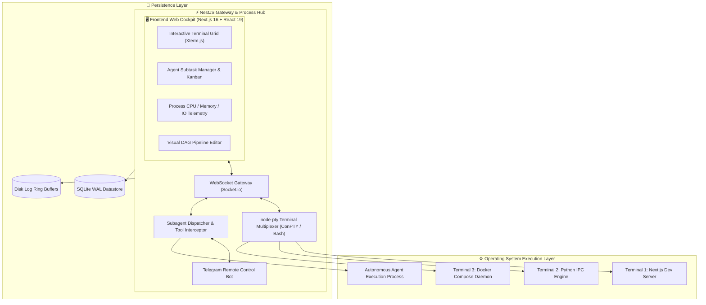
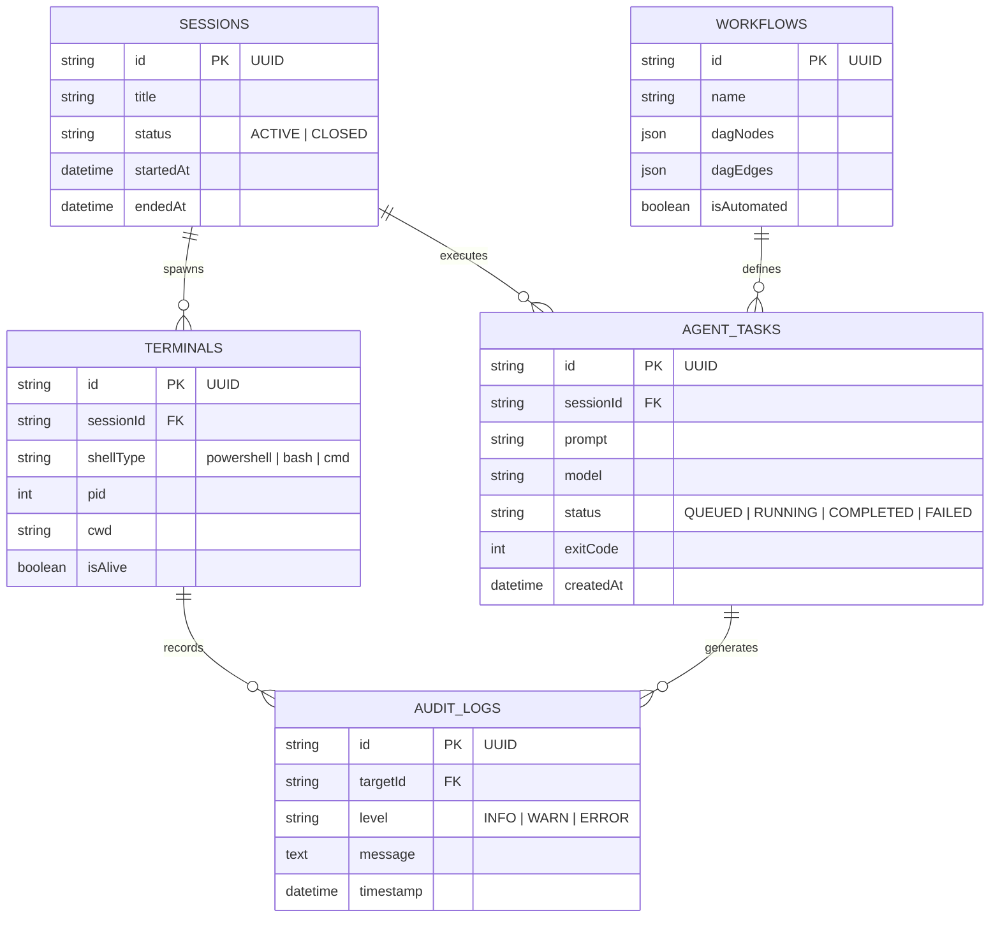
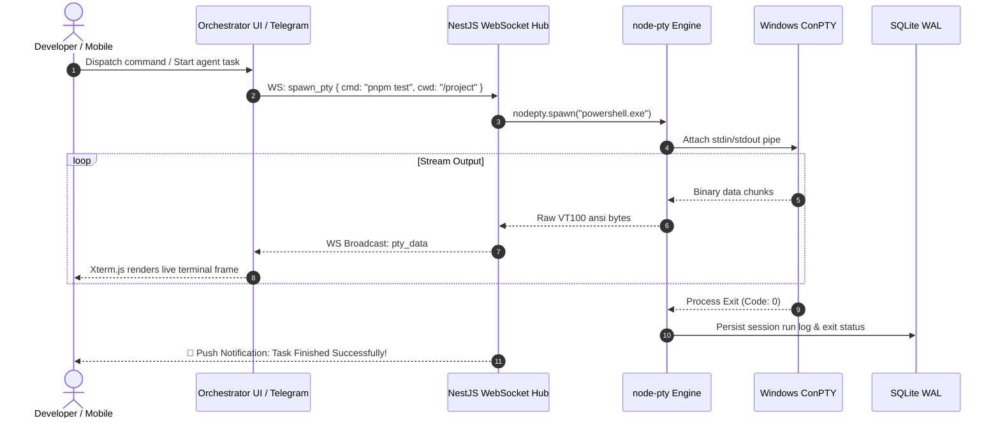

# 🎛️ Orchestrator — Personal AI Agent Command Center & Terminal Multiplexer

<div align="center">


**Centralized developer cockpit managing background terminals, node-pty sessions, subagent execution pipelines, Telegram remote control, and visual automation workflows.**

[System Architecture](#-system-architecture) • [Database ERD](#-database-erd) • [Execution Flow](#-pty-streaming--agent-execution-flow) • [Quick Start](#-quick-start)

</div>

---

## ⚡ Overview

**Orchestrator** is an operating dashboard for autonomous coding agents and background processes. It spawns, monitors, and multiplexes native system shells using **node-pty** over WebSockets, captures streaming terminal logs, triggers workflow graphs, and relays interactive command sessions directly to Telegram for mobile supervision.

---

## 🏗️ System Architecture



---

## 📊 Database ERD



---

## 🔄 PTY Streaming & Agent Execution Flow



---

## 🚀 Quick Start

### 1. Install Dependencies
```bash
pnpm install
```

### 2. Configure Environment
```bash
cp .env.example .env
# Set PORT=4000, TELEGRAM_BOT_TOKEN, JWT_SECRET
```

### 3. Run Development Server
```bash
pnpm run dev
```

Visit `http://localhost:3000` to access the Orchestrator cockpit.

---

## 📄 License
MIT License © **[Ros Rendo](https://github.com/RosRendo)**
